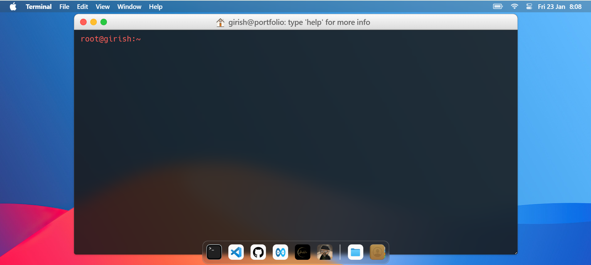

<h2 align="center">
 

<a  href="https://terminal.girishhakki.xyz/"  target="_blank">Girish Hakki</a>

</h2>

 

## Built With

My personal portfolio
<a  href="https://terminal.girishhakki.xyz/"  target="_blank">Girish Hakki</a> made using
ReactJS and styled-components emulating a macOS terminal among other
features. 

This project was built using these following:

-   React.js

-   Styled-components

-   SCSS

-   Framer Motion

## Features

**📖 Multi-Page Layout**

**🎨 Styled with React, Styled-Components and SCSS with easy to customize
colors**

## Getting Started

Clone down this repository. You will need `node.js`, `yarn` and `git` installed
globally on your machine.

## 🛠 Installation and Setup Instructions

1. Installation: `yarn`

2. In the project directory, you can run: `yarn start`

Runs the app in the development mode.

Open [http://localhost:3000](http://localhost:3000) to view it in the browser.

The page will reload if you make edits.

## Usage Instructions

Open the project folder and Navigate to `/src/`.  

You will find all the components used and you can edit your information
accordingly.

### Show your support

Give a ⭐ if you like this website and drop a follow/DM me 

---

## Welcome to Girish's Portfolio Website

Are you looking for a sleek and modern portfolio website that stands out from the crowd? Look no further! Girish's portfolio website is the perfect choice for showcasing your projects and skills.

Built using the latest technologies such as React.js, Node.js, CSS3, and VsCode, this website offers a unique and interactive experience for visitors. The website emulates the look of a macOS terminal and is fully responsive, ensuring that it looks great on any device.

With a multi-page layout and easy to customize colors using React-Js and CSS, this website is perfect for anyone looking to make a lasting impression.
## Getting Started

Clone down this repository and run npm install followed by npm start in the project directory. The website can be accessed by opening http://localhost:3000 in a browser.
## Customizing Your Website

Navigate to the /src/components/ folder to find all the components used in the website. You can edit your information accordingly and make the website your own.
Show Your Support

If you like this website, please give it a ⭐. Your support is greatly appreciated!
## Special Thanks

A special thanks to Boidushya for the help in creating this website.
## Conclusion

Girish's portfolio website is the perfect choice for anyone looking to make a lasting impression. With its unique design, interactive features and easy customization options, you're sure to stand out from the crowd. Give it a try today and see for yourself!
  

